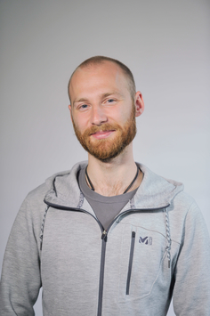

::: {.about-portrait}
{fig-alt="Portrait of René Skukies"}

\(c) SimTech/Max Kovalenko
:::

Hey,

my name is René Skukies. Currently, I am a PhD Student in the Computational Cognitive Science group. We are situated at the University of Stuttgart and part of the [SimTech Institute](https://www.simtech.uni-stuttgart.de). My CV (as of 01.2026) can be found [here](https://kdrive.infomaniak.com/app/share/697625/d7c413f4-7fae-4ea7-9747-992462a57da3).

I am interested in, and working on the development and validation of new neuroscientific methods, specifically for signal analysis of M/EEG recordings. The main focus of my PhD is to investigate the uses and further developments of the regression-ERP approach. I am additionally interested in (multimodal) perception, awareness and consciousness.

Lastly, if I'm not doing science I enjoy hiking, climbing, bee keeping and generally being out in nature. To get an idea of how that looks (and partly to make me look more human than just a wall of text) [here are some pictures of me in the wild](https://kdrive.infomaniak.com/app/share/697625/39d336a5-304e-43e6-8d44-66378f26f1ef)

::: {style="clear: both"}
:::

## Contact Me/ Find Me Elsewhere

Mail: [science@reneskukies.de](mailto:science@reneskukies.de)

BlueSky: [\@theneurocookies.bsky.social](https://bsky.app/profile/theneurocookies.bsky.social)

GitHub: [René Skukies](https://github.com/ReneSkukies)

ORCID: [0000-0002-4124-4584](https://orcid.org/0000-0002-4124-4584)

Google Scholar: [René Skukies](https://scholar.google.com/citations?user=Pfm0Ix8AAAAJ&hl=en)

Education

*Nov.2020 - April.2026*: Dr. rer. nat./ PhD Computational Cognitive Science; University of Stuttgart - Centre for Simulation Science

*2018 - 2020*: M.Phil. Cognitive Neuroscience; University of Oslo \
*Thesis: ['Validation of measures of consciousness using Propofol anaesthesia'](https://www.duo.uio.no/handle/10852/79300?show=full)* \
<!--Can be found  [here](https://www.duo.uio.no/handle/10852/79300?show=full)-->

*2014 - 2017*: B.Sc. Psychology; Innsbruck University \
*Thesis: 'Leader-Member-Exchange and Right-Wing-Authoritarianism: A political concept in an organisational setting'*

Publications

::: {#refs}
:::

Full list on [ORCID](https://orcid.org/0000-0002-4124-4584).

